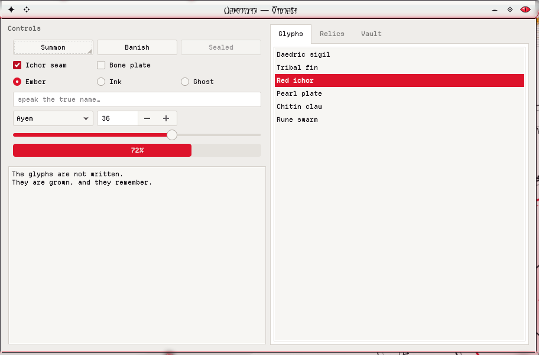
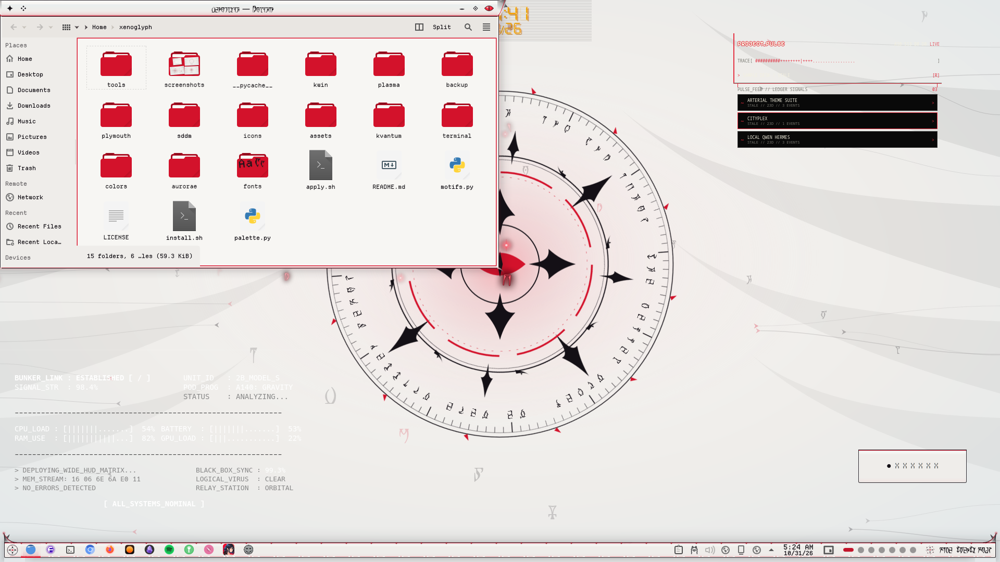

# Xenoglyph — Kvantum Theme

Kvantum widget style in pearl and bone with red ichor accents: red checks, sliders and progress bars, ink text, animated hover states.



Xenoglyph is an alien-white, cybertribal look for KDE Plasma 6: pearl and bone surfaces, black tribal ink that sweeps into fins, horns and claws, a red ichor seam through everything, Daedric script, and motion everywhere.

## Features

- Built on KvArc's engine map, recoloured to the Xenoglyph palette: pearl views, bone headers, shell buttons and chitin borders.
- Red ichor for checks, radios, sliders, progress bars, focus rings and selections.
- Animated state changes, so hover and press fade rather than snap.
- Solid and light, with no blur. Matches the Xenoglyph colour scheme.



## Requirements

Kvantum (`kvantum` package), with the widget style set to kvantum.

## Install

```bash
git clone https://github.com/numbpill3d/xenoglyph-kvantum
cd xenoglyph-kvantum && ./install.sh
```

Or from the KDE Store: Extract to `~/.config/Kvantum/` and select **Xenoglyph** in Kvantum Manager, then set the Application Style to kvantum.

## The rest of the suite

| piece | repo |
|---|---|
| SDDM login | [xenoglyph-sddm](https://github.com/numbpill3d/xenoglyph-sddm) |
| Plymouth boot splash | [xenoglyph-plymouth](https://github.com/numbpill3d/xenoglyph-plymouth) |
| Global theme + splash screen | [xenoglyph-global](https://github.com/numbpill3d/xenoglyph-global) |
| Plasma style (panel, popups) | [xenoglyph-plasma](https://github.com/numbpill3d/xenoglyph-plasma) |
| Aurorae window decoration | [xenoglyph-aurorae](https://github.com/numbpill3d/xenoglyph-aurorae) |
| Floating runes (KWin script) | [xenoglyph-runes](https://github.com/numbpill3d/xenoglyph-runes) |
| Window open/close animation (KWin effect) | [xenoglyph-unfurl](https://github.com/numbpill3d/xenoglyph-unfurl) |
| Animated + still wallpaper | [xenoglyph-wallpaper](https://github.com/numbpill3d/xenoglyph-wallpaper) |
| Sigil clock widget | [xenoglyph-sigil](https://github.com/numbpill3d/xenoglyph-sigil) |
| Colour scheme | [xenoglyph-colors](https://github.com/numbpill3d/xenoglyph-colors) |
| Icon theme | [xenoglyph-icons](https://github.com/numbpill3d/xenoglyph-icons) |
| Konsole + kitty colours | [xenoglyph-konsole](https://github.com/numbpill3d/xenoglyph-konsole) |

Everything at once, with the generators: [xenoglyph](https://github.com/numbpill3d/xenoglyph).

## Tags

`xenoglyph` `kde` `kde-plasma` `plasma6` `light-theme` `white` `red` `cybertribal` `tribal` `alien` `daedric` `otherworldly` `animated` `kvantum` `qt-style` `widget-style` `qt6` `qt5`

## Credits and licence

By splicer scorn (voidrane). GPL-3.0-or-later.
Engine map adapted from KvArc by Tsu Jan (Kvantum, GPL-3.0).
